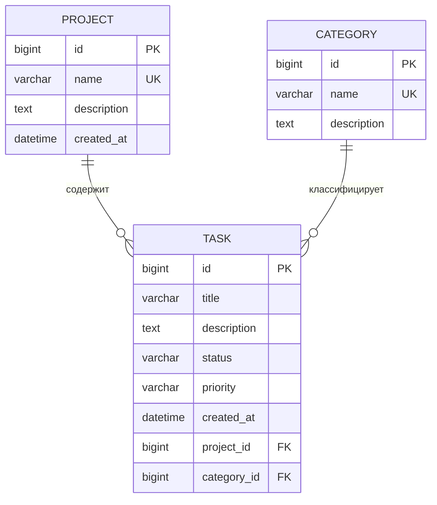

# Task Manager — Backend на Django

Сквозной учебный проект: Backend-система управления задачами (Django 6, SQLite).

## Запуск

```bash
python -m venv venv
venv\Scripts\activate          # Windows  (Linux/macOS: source venv/bin/activate)
pip install django
python manage.py migrate
python manage.py seed_data     # тестовые данные: 2 проекта, 3 категории, 8 задач
python manage.py createsuperuser
python manage.py runserver
```

- Админ-панель: http://127.0.0.1:8000/admin/
- Тесты: `python manage.py test`

---

# ПР 5. Предметная область и модели

## Назначение системы
Task Manager — сервис для командной работы над задачами: задачи группируются
по проектам и категориям, имеют статус и приоритет.

## Функции системы
1. Создание, просмотр, изменение и удаление задач (CRUD).
2. Группировка задач по проектам.
3. Классификация задач по категориям (Backend, Frontend, Bugfix …).
4. Статусы задач: `todo` → `in_progress` → `done`.
5. Приоритеты задач: `low`, `medium`, `high`.
6. Управление всеми данными через Django Admin (поиск, фильтры).
7. JSON REST API с валидацией и CSRF-защитой.

## Сущности и поля

| Модель | Поле | Тип | Примечание |
|---|---|---|---|
| **Project** | id | BigAutoField | PK |
| | name | CharField(150) | уникальное |
| | description | TextField | необязательное |
| | created_at | DateTimeField | auto_now_add |
| **Category** | id | BigAutoField | PK |
| | name | CharField(100) | уникальное |
| | description | TextField | необязательное |
| **Task** | id | BigAutoField | PK |
| | title | CharField(200) | обязательное |
| | description | TextField | необязательное |
| | status | CharField(20) | todo / in_progress / done |
| | priority | CharField(10) | low / medium / high |
| | created_at | DateTimeField | auto_now_add |
| | project | ForeignKey → Project | `CASCADE`, `related_name='tasks'`, null |
| | category | ForeignKey → Category | `SET_NULL`, `related_name='tasks'`, null |

## ER-диаграмма



Связи: **Project 1 — N Task** (удаление проекта удаляет его задачи),
**Category 1 — N Task** (при удалении категории у задач поле становится NULL).

## Миграции
- `0001_initial` — модель Task;
- `0002_project_category_priority` — Project, Category, поле `priority`, связи в Task
  (поля nullable / с default, поэтому существующие задачи не теряются).

---

# ПР 6. REST API и CRUD для Task

## CSRF-защита
Защита **не отключена**. Для POST/PUT/PATCH/DELETE нужно:
1. Выполнить `GET /api/csrf/` — сервер установит cookie `csrftoken`
   (в Postman cookie сохранится автоматически).
2. Передавать значение токена в заголовке `X-CSRFToken`.

(Исключение — учебный `/echo/` из ПР 2, он освобождён от CSRF точечно через `@csrf_exempt`.)

## Эндпоинты

Доступны по двум адресам: `/tasks/…` и `/api/tasks/…`.

| Метод | URL | Действие | Успех | Ошибки |
|---|---|---|---|---|
| GET | `/tasks/` | список задач | 200 | — |
| POST | `/tasks/` | создать задачу | 201 | 400, 403 |
| GET | `/tasks/<id>/` | одна задача | 200 | 404 |
| PUT | `/tasks/<id>/` | полная замена | 200 | 400, 403, 404 |
| PATCH | `/tasks/<id>/` | частичное обновление | 200 | 400, 403, 404 |
| DELETE | `/tasks/<id>/` | удалить | 204 | 403, 404 |

Прочие коды: `405` — метод не поддерживается, `403` — нет/неверный CSRF-токен.

## Валидация
- `title` — **обязателен** для POST и PUT, непустая строка, ≤ 200 символов;
- `status` ∈ `todo | in_progress | done`; `priority` ∈ `low | medium | high`;
- `project`, `category` — id существующей записи или `null`;
- тело запроса — корректный JSON-объект, иначе 400.

PUT — полная замена ресурса: не переданные необязательные поля сбрасываются к значениям по умолчанию.
PATCH меняет только переданные поля.

## Примеры запросов (реальные результаты)

```text
$ curl localhost:8000/tasks/1/
{"id": 1, "title": "Создать модели", "description": "", "status": "done", "priority": "high", "project": 1, "category": 1, "created_at": "..."}
[HTTP 200]

$ curl -X POST localhost:8000/tasks/ -H "Content-Type: application/json" -d '{"title":"x"}'      # без CSRF-токена
[HTTP 403]  CSRF verification failed

$ curl -X POST localhost:8000/tasks/ -H "Content-Type: application/json" -H "X-CSRFToken: <token>" \
       -d '{"title":"Проверить API","priority":"high","project":1,"category":1}'
{"id": 9, "title": "Проверить API", "description": "", "status": "todo", "priority": "high", "project": 1, "category": 1, ...}
[HTTP 201]

$ curl -X POST ... -d '{"title":"","status":"bad"}'
{"error": "Ошибка валидации", "details": {"title": "Обязательное поле: непустая строка", "status": "Допустимые значения: todo, in_progress, done"}}
[HTTP 400]

$ curl -X PUT localhost:8000/tasks/9/ ... -d '{"title":"Проверить API (обновлено)","status":"done"}'
{"id": 9, "title": "Проверить API (обновлено)", ..., "status": "done", "priority": "medium", "project": null, "category": null, ...}
[HTTP 200]

$ curl -X DELETE localhost:8000/tasks/9/ -H "X-CSRFToken: <token>"
[HTTP 204]

$ curl localhost:8000/tasks/9/
{"error": "Задача не найдена"}
[HTTP 404]
```

### Postman
1. `GET http://127.0.0.1:8000/api/csrf/` — получаем cookie.
2. Для остальных запросов добавьте заголовок `X-CSRFToken` со значением `csrfToken` из ответа
   и `Content-Type: application/json`, тело — raw JSON.

## Автотесты
`python manage.py test` — 15 тестов (CRUD, валидация, 400/403/404/405, CSRF, связи моделей).

## Ответы на вопросы для защиты
**ПР 5.** Сущности выбраны по предметной области: задача — центральная, проект и категория — способы её группировки.
Миграции — файлы, описывающие изменения схемы БД; они применяются командой `migrate` и версионируют структуру.
Связи: Project→Task и Category→Task (один ко многим, `ForeignKey`).

**ПР 6.** CRUD — Create, Read, Update, Delete. GET только читает (безопасный, идемпотентный),
POST создаёт новый ресурс, PUT полностью заменяет существующий (идемпотентный).
400 — клиент прислал некорректные данные (плохой JSON, не прошла валидация);
404 — запрошенный ресурс не найден.
